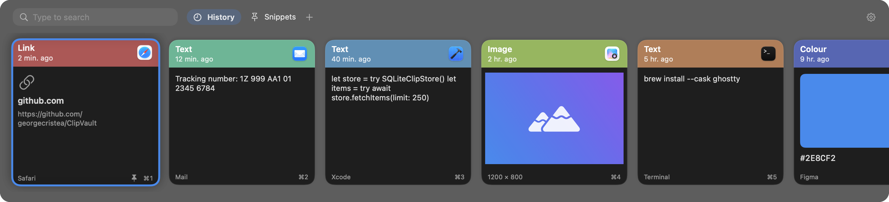

# ClipVault

[](https://github.com/georgecristea/ClipVault/actions/workflows/ci.yml)
[](https://github.com/georgecristea/ClipVault/releases/latest)

[](LICENSE)

**Private clipboard history for macOS.** ClipVault keeps the text, links, colours, images and files
you copy. Press **⇧⌘V** in any app and your history slides up from the bottom of the screen as a
row of cards. Type to search, press Return, and the clip is pasted where you were working.

It stays on your Mac: no account, no network access. Password managers are skipped by default.

<p align="center"></p>

## Features

- **The bar.** ⇧⌘V (or the menu-bar icon) opens a full-width bar on the screen you're working on.
  Each card shows the source app, when you copied it and a preview of the content.
- **Paste straight into your app.** Return pastes the selected card into the app you came from.
  ⇧Return pastes as plain text. Select several cards (⌘-click, ⇧-click or ⇧←/→) to paste them
  together: text is joined, images arrive as separate items.
- **Everything you copied, intact.** Rich text, HTML, links and multiple files are stored with all
  their formats, so they paste back exactly as copied. Links and colours get their own cards.
- **Type to search.** Every word you type must appear in the clip's text or title.
- **Pinboards.** Keep clips you reuse on named pinboards, shown as tabs (⌘←/⌘→ to switch). Clips on
  a pinboard never expire. Rename any clip to find it later.
- **Preview.** Space shows the whole text, the full image or the file list.
- **No duplicates.** Copying something already in your history moves it to the front.
- **Pause** capture for 15 minutes, an hour, 8 hours or until you resume, from the menu-bar menu.
- **Exclusions.** Apple Passwords, Keychain Access, 1Password, Bitwarden, KeePassXC, LastPass,
  Dashlane, Enpass, Keeper and RoboForm are excluded out of the box; add any app, or exclude the
  frontmost one with one click. Clipboard data that apps mark as concealed, transient or
  auto-generated ([nspasteboard.org](http://nspasteboard.org)) is never saved.
- **Retention you control.** 30 days by default; pick 5 to 365 days on a slider, type any number of
  days, or keep forever. ClipVault asks before deleting anything because of a shorter period.
- **Launch at login**, from Settings.

### Pasting needs Accessibility

To type ⌘V into the app you came from, ClipVault needs **Accessibility** permission (System
Settings → Privacy & Security → Accessibility); Settings has a **Grant…** button. Without it, or
with "Paste into the active app" turned off, picking a clip copies it and you paste with ⌘V
yourself.

If the switch is on but pasting still doesn't work (this happens after updating to a build with a
different signature), click **Grant…** in Settings again: ClipVault clears its old entry and asks
afresh, and you switch it on once more.

### Keyboard

| Key | Action |
|-----|--------|
| ⇧⌘V | show or hide the bar (change it in Settings) |
| type | search |
| ← / → | move the selection (⇧ to extend it) |
| Return | paste the selected clip(s) |
| ⇧Return | paste as plain text |
| ⌘1 … ⌘9 | paste the clip at that position |
| Space | preview |
| ⌘← / ⌘→ | switch between History and pinboards |
| ⌘C | copy without pasting |
| ⌘P | pin to "Pinned", or unpin |
| ⌘⌫ | delete |
| ⌘, | settings |
| Esc | close the preview, clear the search, then close the bar |

Right-click a card to pin it to a pinboard, rename it or delete it.

## Install

### Download

Get **ClipVault.dmg** from the [latest release](https://github.com/georgecristea/ClipVault/releases/latest)
and drag ClipVault into Applications.

The app isn't notarized by Apple yet, so macOS blocks the first launch. Open it once with
**System Settings → Privacy & Security → Open Anyway**, or run:

```sh
xattr -dr com.apple.quarantine /Applications/ClipVault.app
```

### Build from source

Requires macOS 14 or newer and Xcode 15+ (or the Xcode command line tools).

```sh
git clone https://github.com/georgecristea/ClipVault.git
cd ClipVault
./scripts/install.sh   # universal release build → /Applications/ClipVault.app, then launches it
```

## Privacy and security

- History lives in `~/Library/Application Support/ClipVault`: a SQLite index plus one payload file
  per item. Files are owner-only (`0600`) and the folder is excluded from Time Machine.
- Deleting an item removes its payload file; the database uses `secure_delete` and is vacuumed after
  deletes. Copies that already exist in APFS snapshots or other backups are outside ClipVault's
  reach.
- Clips over 100 MB are skipped. Content already in the history isn't stored twice.
- No network code, no analytics, no crash reporting.

Found a security problem? See [SECURITY.md](SECURITY.md).

## How it works

A timer checks the pasteboard's change count every 0.75 s. New content is read with all of its
items and formats, checked against the privacy markers, the exclusion rules and the frontmost app,
classified (files, then text, links and colours, then images) and written to the store. Pasting
writes the clip back (tagged so ClipVault doesn't capture it again) and sends ⌘V with the key that
types "v" on your keyboard layout.

```
Sources/ClipVault/
  App/        AppDelegate, AppState (clip actions), AppSettings, RetentionPolicy, DemoMode
  Services/   ClipboardMonitor, PasteboardItems (snapshot + markers), ClipboardClassifier, PasteboardWriter
  Storage/    ClipStore protocol, SQLiteClipStore (system libsqlite3), PayloadCodec
  UI/Bar/     BarController, BarPanel, BarModel, BarView, ClipCardView, ScreenLocator
  UI/         StatusBarController (menu), SettingsWindow, SettingsView, ExclusionsView, ClipPreview, AboutView
```

The UI is built on [MacUtilityKit](https://github.com/georgecristea/MacUtilityKit), the shared
toolkit behind this app, [VoxKey](https://github.com/georgecristea/VoxKey) and
[Upkeep](https://github.com/georgecristea/upkeep).

## Development

```sh
swift build    # compile
swift test     # classifier, store, writer, bar model and settings tests
./scripts/install.sh
.build/debug/ClipVault --demo                        # sample history; never reads your clipboard
.build/debug/ClipVault --demo --snapshot out.png     # render the bar to a PNG and quit
```

Always run the app from `/Applications`, not from `.build` or `dist/`. Packaging scripts:
`scripts/package-app.sh` (app bundle), `scripts/make-dmg.sh`, `scripts/release.sh <tag>`
(GitHub release), and `scripts/notarize.sh` (Developer ID signing and notarization, needs an
Apple Developer account). [CLAUDE.md](CLAUDE.md) has the architecture notes and macOS gotchas, for
humans and coding agents alike. See [CONTRIBUTING.md](CONTRIBUTING.md).

## License

[MIT](LICENSE) © DeepDive Solna AB. Made by [George Cristea](https://github.com/georgecristea).
