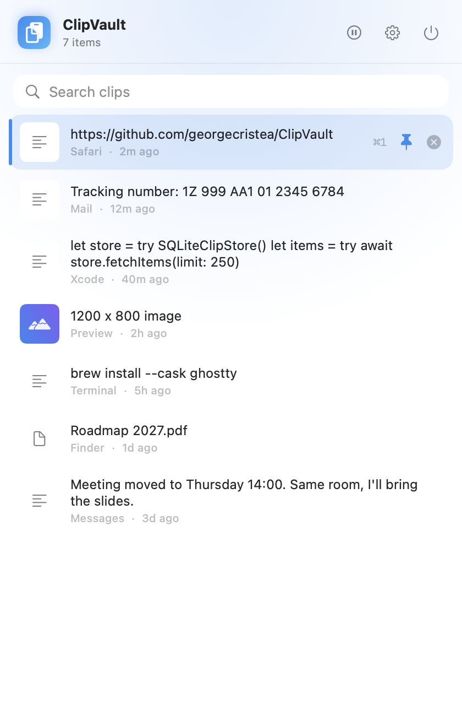

# ClipVault

[](https://github.com/georgecristea/ClipVault/actions/workflows/ci.yml)
[](https://github.com/georgecristea/ClipVault/releases/latest)

[](LICENSE)

**Private clipboard history for the macOS menu bar.** ClipVault keeps the text, images and files you
copy so you can find them again. Click the menu bar icon, type a few letters, press Return, and the
item is back on your clipboard.

It stays on your Mac: no account, no network access, no permissions to grant. Password managers
are skipped by default.

<p align="center"></p>

## Features

- **Text, images and files.** Plain text, images (stored as PNG) and Finder file references.
- **Type to search.** Start typing as soon as the popover opens.
- **Keyboard first.** Arrow keys, Return, ⌘1–⌘9, pin, delete (see below).
- **Preview panel.** Hover or select an item to see the full text, the image, or the file list.
- **Pin** the items you reuse; pinned items sort first and never expire.
- **Pause** capture with one click when you're about to copy something sensitive.
- **Exclusions.** 1Password, Bitwarden, KeePassXC, LastPass, Dashlane and Keychain Access are
  excluded out of the box; add any app, or exclude the frontmost one with one click. Clipboard data
  that apps mark as concealed, transient or auto-generated ([nspasteboard.org](http://nspasteboard.org))
  is never saved.
- **Retention you control.** 7 days by default, anything from 1 day to 10 years, or keep forever.
- **Launch at login**, from Settings.

Picking an item copies it and returns you to the app you were in. Paste with ⌘V as usual.
ClipVault never types into other apps, which is why it needs no Accessibility permission.

### Keyboard

| Key | Action |
|-----|--------|
| type | search |
| ↑ / ↓ | move the selection |
| Return | copy the selected item |
| ⌘1 … ⌘9 | copy the item at that position |
| ⌘P | pin or unpin |
| ⌘⌫ | delete |
| ⌘, | settings |
| Esc | clear the search, then close |

## Install

### Download

Get **ClipVault.dmg** from the [latest release](https://github.com/georgecristea/ClipVault/releases/latest)
and drag ClipVault into Applications.

The app isn't notarized by Apple yet, so macOS blocks the first launch. Open it once with
**System Settings → Privacy & Security → Open Anyway**, or run:

```sh
xattr -dr com.apple.quarantine /Applications/ClipVault.app
```

### Build from source

Requires macOS 14 or newer and Xcode 15+ (or the Xcode command line tools).

```sh
git clone https://github.com/georgecristea/ClipVault.git
cd ClipVault
./scripts/install.sh   # universal release build → /Applications/ClipVault.app, then launches it
```

## Privacy and security

- History lives in `~/Library/Application Support/ClipVault`: a SQLite index plus one payload file
  per item. Files are owner-only (`0600`) and the folder is excluded from Time Machine.
- Deleting an item removes its payload file; the database uses `secure_delete` and is vacuumed after
  deletes. Copies that already exist in APFS snapshots or other backups are outside ClipVault's
  reach.
- Items over 100 MB are skipped. An item identical to the latest one isn't stored twice.
- No network code, no analytics, no crash reporting.

Found a security problem? See [SECURITY.md](SECURITY.md).

## How it works

A timer checks the pasteboard's change count every 0.75 s. New content is classified (files win over
images, images over text), checked against the exclusion rules and the frontmost app, then written
to the store.

```
Sources/ClipVault/
  App/        AppDelegate, AppState (central ObservableObject), AppSettings
  Services/   ClipboardMonitor (pasteboard polling), ClipboardClassifier
  Storage/    ClipStore protocol, SQLiteClipStore (system libsqlite3)
  UI/         StatusBarController (NSStatusItem + popover), HistoryView, ClipPreview, SettingsView, …
```

The UI is built on [MacUtilityKit](https://github.com/georgecristea/MacUtilityKit), the shared
toolkit behind this app, [VoxKey](https://github.com/georgecristea/VoxKey) and
[Upkeep](https://github.com/georgecristea/upkeep).

## Development

```sh
swift build    # compile
swift test     # classifier and SQLite store tests
./scripts/install.sh
.build/debug/ClipVault --demo                        # sample history; never reads your clipboard
.build/debug/ClipVault --demo --snapshot out.png     # render the popover to a PNG and quit
```

Always run the app from `/Applications`, not from `.build` or `dist/`. Packaging scripts:
`scripts/package-app.sh` (app bundle), `scripts/make-dmg.sh`, `scripts/release.sh <tag>`
(GitHub release), and `scripts/notarize.sh` (Developer ID signing and notarization, needs an
Apple Developer account). [CLAUDE.md](CLAUDE.md) has the architecture notes and macOS gotchas, for
humans and coding agents alike. See [CONTRIBUTING.md](CONTRIBUTING.md).

## License

[MIT](LICENSE) © DeepDive Solna AB. Made by [George Cristea](https://github.com/georgecristea).
